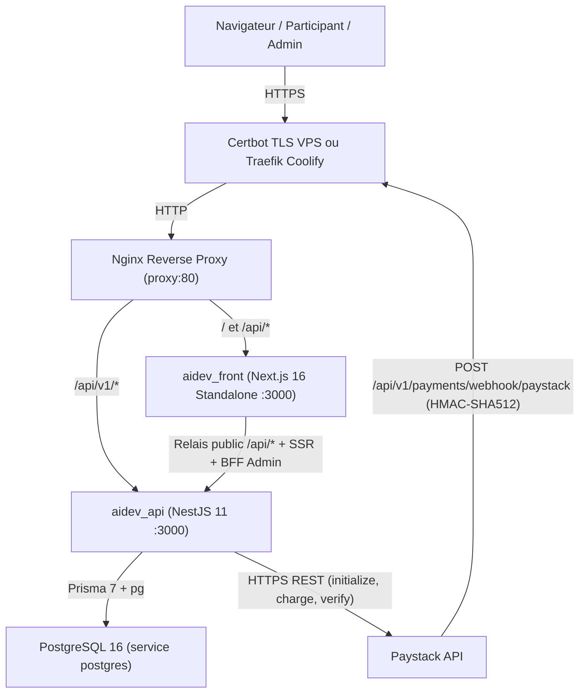

# Architecture Technique - Aidev Classroom (`aidevclassroom`)

Ce document présente l'architecture globale du monorepo `aidevclassroom` (plateforme AIDevClassroom : vitrine publique, tunnel d'inscription avec paiement échelonné Paystack/Mobile Money et panneau d'administration) selon quatre axes : stack et dépendances, organisation modulaire, flux de données et sécurité, puis état des lieux et dette technique.

---

## 1. Stack & Dépendances

Le dépôt regroupe deux applications TypeScript indépendantes orchestrées par Docker Compose et déployées sur un VPS derrière Nginx :

| Composant | Rôle | Technologies et versions vérifiées |
|---|---|---|
| Backend API (`aidev_api`) | API REST métier, persistance, intégration Paystack, RBAC admin | Node.js 22 (`node:22-alpine`), TypeScript `5.7.3`, NestJS 11, Prisma `7.10.1` (`@prisma/adapter-pg`), `pg` `8.23.1`, Passport JWT, `bcrypt` 6 (coût 12), `class-validator`, `class-transformer`, `@nestjs/throttler`, `@nestjs/swagger`, Jest 30 |
| Frontend (`aidev_front`) | Site vitrine SSR/RSC, parcours d'inscription/paiement, relais API, panneau `/admin` | Node.js 22 (`node:22-alpine`), Next.js `16.4.2` (App Router, `output: "standalone"`), React `19.3.0`, React DOM `19.3.0`, TypeScript `^5`, Tailwind CSS `^4` (`@tailwindcss/turbopack` `^4`), GSAP `^3.15.0` (`@gsap/react` `^2.1.2`), Lenis `^1.3.27`, Three.js `^0.180.0`, `@hugeicons/react` `^1.1.10` (`@hugeicons/core-free-icons` `^4.3.5`) |
| Base de données | SGBD relationnel conteneurisé par pile | PostgreSQL 16 (`postgres:16-alpine`) avec volume persistant dédié dans chacun des 3 Compose (`compose.dev.yml`, `compose.prod.yml`, `compose.coolify.yml`) |
| Passerelle de paiement | Paiement Mobile Money direct (`Charge`) et page hébergée (`Checkout`) en XOF | Paystack REST API (`POST /transaction/initialize`, `POST /charge`, `GET /transaction/verify/:reference`, webhook `charge.success`) |
| Reverse Proxy & Infra | Terminaison HTTP/HTTPS, routage `/api/v1/` vs `/api/`, conteneurisation | Nginx `1.27-alpine`, Docker multi-stage (`base`/`dev`/`build`/`prod`), Docker Compose (`compose.dev.yml`, `compose.prod.yml`, `compose.coolify.yml`) |
| CI/CD | Intégration et déploiement continu sur `main` | GitHub Actions (`.github/workflows/ci-deploy-prod.yml`), scripts Bash (`scripts/ci-deploy.sh`, `scripts/deploy.sh`, `scripts/migrate.sh`, `scripts/rollback.sh`) |

---

## 2. Architecture & Organisation

### 2.1 Pattern global

L'architecture suit un modèle **client-serveur découplé en monorepo** :

- **`aidev_api`** est structuré selon l'**architecture modulaire NestJS** (Contrôleurs -> Services -> PrismaService/PaystackService, avec DTOs validés, Guards, Filters et Interceptors transverses). Tous les endpoints exposent une enveloppe uniforme `{ data, meta }` (via `TransformInterceptor`) et un format d'erreur normalisé `{ statusCode, code, message }` (via `AllExceptionsFilter`).
- **`aidev_front`** combine des **Server Components Next.js 16** (rendu SSR de la landing page et du panneau `/admin` avec Server Actions et cookie `httpOnly`) et des **Client Components** (`"use client"`) pour les animations WebGL/GSAP, la modale d'inscription, le tunnel de paiement Mobile Money et le stockage local (`localStorage`).
- **Relais même-origine (`/api/[...chemin]`)** : les appels browser publics passent par le Route Handler Next.js [`route.ts`](file:///c:/projets/les_ultra_dev/aidevclassroom/aidev_front/src/app/api/[...chemin]/route.ts), qui relaie en serveur-à-serveur vers `aidev_api` via le réseau Docker interne sans exposer l'URL backend ni dépendre du CORS navigateur.
- **Administration via BFF (Backend-for-Frontend)** : toutes les actions `/admin/*` passent par des Server Actions et appels serveur Next.js lisant le cookie `httpOnly` `aidevsprint_admin`, de sorte que le JWT administrateur n'est jamais exposé au JavaScript navigateur.

### 2.2 Rôle des dossiers racine et des sous-projets

| Dossier / Fichier | Rôle principal |
|---|---|
| `aidev_api/` | Backend NestJS 11 : code source (`src/`), schéma et migrations Prisma (`prisma/`), documentation API historique (`docs/frontend/`), tests E2E (`test/`), scripts (`scripts/deploy-prod.sh`). |
| `aidev_api/src/` | Cœur applicatif : `main.ts`, `app.module.ts`, `config/` (validation env via `validateEnv`), `prisma/`, `common/` (`decorators`, `filters`, `guards`, `interceptors`), `cli/create-admin.ts` et 9 modules métier (`auth`, `admins`, `students`, `sprints`, `site-content`, `enrollments`, `payments`, `dashboard`, `health`). |
| `aidev_api/prisma/` | Schéma PostgreSQL (`schema.prisma`), configuration Prisma 7 (`prisma.config.ts`), seeding idempotent (`seed.ts`), migrations PostgreSQL (`0001_init_pg`, `0002_duo_forfaits`, `0003_partner_phone`, `0004_dynamic_sprints_and_content`) et sauvegarde MySQL historique (`migrations-mysql-backup/`). |
| `aidev_front/` | Frontend Next.js 16 : pages App Router (`src/app/`), proxy/middleware (`src/proxy.ts`), composants UI/motion/admin (`src/components/`), clients API et hooks (`src/lib/`), assets publics (`public/` : formateurs, badges, logos). |
| `design/` | Maquettes et ressources graphiques déplacées à la racine du dépôt. |
| `nginx/` | Configuration du conteneur proxy `nginx:1.27-alpine` (`nginx.conf`, `conf.d/default.conf`) routant `/api/v1/` vers `backend:3000` avant `/api/` et `/` vers `frontend:3000`. |
| `scripts/` | Outils d'exploitation Bash : `common.sh`, `start.sh`, `stop.sh`, `restart.sh`, `build.sh`, `migrate.sh`, `deploy.sh`, `ci-deploy.sh`, `rollback.sh`, `logs.sh`, `status.sh`. |
| `deploy/` | Guides opérationnels d'infrastructure (`README.md`, `database-setup.md`, `environments-and-compose.md`, `nginx-and-ssl.md`, `operations-and-runbook.md`, `vps-setup-guide.md`). |
| `docs/` | Base de connaissances unifiée : `SESSION.md`, `workflows/`, `prd/`, `api/`, `admin.md`, `design.md`, `stack.md`, `pour-youssouf.md`. |
| `.github/workflows/` | Pipeline CI/CD (`ci-deploy-prod.yml`). |
| `.githooks/` | Hook Git `commit-msg` appliquant le format de commit conventionnel en français défini dans [`AGENTS.md`](file:///c:/projets/les_ultra_dev/aidevclassroom/AGENTS.md). |

### 2.3 Frontières modulaires et conventions

- **Frontières backend (`aidev_api/src/`)** : chaque domaine possède son contrôleur, son service, son module et ses DTOs (`admins`, `auth`, `dashboard`, `enrollments`, `health`, `payments`, `prisma`, `site-content`, `sprints`, `students`). `PaymentsService` s'appuie sur `PaystackService` (client HTTP isolé avec `AbortSignal.timeout`) et `balance.util.ts` (fonctions pures de calcul de solde et de validation de montant). `SprintsService` s'appuie sur `enrolled-count.util.ts` (`thresholdForEnrollment`, `isEnrolled`, `countEnrolled`) pour calculer les dossiers qualifiés (`enrolledCount`) et les places occupées (`enrolledSeats`, un dossier `DUO` qualifié valant 2 places) dès que les paiements `SUCCESS` atteignent le minimum du sprint.
- **Frontières frontend (`aidev_front/src/`)** :
  - `src/lib/api.ts` : couche bas niveau (résolution base URL SSR vs navigateur `/api`, `ErreurApi`, `ErreurReseau`, validation d'hôtes Paystack).
  - `src/lib/edition.ts` et `src/lib/contenu.ts` : mapping des sprints publics vers le modèle `Edition` (avec replis `FAITS_LOCAUX`, `MODULES_DEFAUT`) et récupération du contenu éditorial global via `GET /site-content` (`recupereContenuSite()`).
  - `src/lib/usePlacesSprint.ts` : hook client synchronisant en direct le compteur `inscrits / quota` via `GET /api/sprints/:id/enrolled-count` et l'événement `aidev:inscription-maj`.
  - `src/lib/paiement.ts` : client d'inscription, recherche par e-mail, initialisation/vérification Paystack/Charge, gestion du `localStorage` (`aidevsprint.*`).
  - `src/lib/admin/` : couche session (`session.ts`, cookie `aidevsprint_admin`), client API admin (`api.ts`), types et transitions (`types.ts`).
- **Conventions linguistiques** : `aidev_api` utilise des identifiants et champs API en anglais (`firstName`, `priceXof`, `TrackingTokenGuard`), tandis que `aidev_front` utilise des identifiants métier en français (`FormulaireInscription`, `lancePaiement`, `StatutSprint`) mappés vers les contrats anglais de l'API.

---

## 3. Flux de données & Sécurité

### 3.1 Points d'entrée réseau et HTTP

1. **Production VPS (`compose.prod.yml`) & Coolify (`compose.coolify.yml`)** :
   - Sur VPS autonome, `proxy` écoute directement sur les ports `80` et `443` avec support Certbot.
   - Sur Coolify, Traefik gère le TLS en frontal et transfère le trafic vers le port interne `80` du service `proxy`.
2. **Nginx interne ([`default.conf`](file:///c:/projets/les_ultra_dev/aidevclassroom/nginx/conf.d/default.conf))** :
   - `/healthz` : healthcheck Nginx local (`200 healthy`).
   - `/api/v1/*` : proxy direct vers `backend:3000` (API NestJS et webhook Paystack). Ce bloc précède `/api/` pour éviter toute collision avec le relais Next.js.
   - `/api/*` : proxy vers `frontend:3000` (relais Next.js qui accepte uniquement les préfixes `sprints`, `site-content`, `enrollments`, `payments`, `students`, `health` et appelle le backend en serveur-à-serveur).
   - `/*` : proxy vers `frontend:3000` (pages SSR publiques et panneau `/admin`).
3. **Bootstrap NestJS ([`main.ts`](file:///c:/projets/les_ultra_dev/aidevclassroom/aidev_api/src/main.ts))** :
   - Capture du `rawBody` via `express.json({ verify })` pour la vérification cryptographique des webhooks Paystack.
   - `ValidationPipe({ whitelist: true, forbidNonWhitelisted: true, transform: true })` rejetant tout champ DTO non déclaré (`400`).
   - CORS restreint à `FRONTEND_URL.split(',')`.
   - Swagger désactivé en production (`SWAGGER_ENABLED=false`), activable en dev/preprod sur `/api/docs`.

### 3.2 Gestion d'état (Base, BFF, Navigateur)

- **Persistance PostgreSQL** : 8 tables (`users`, `students`, `sprints`, `enrollments`, `payments`, `site_settings`, `trainers`, `faqs`) avec contraintes d'intégrité référentielle `ON DELETE RESTRICT ON UPDATE CASCADE` sur le noyau transactionnel.
- **Calcul des soldes** : dérivé dynamiquement à partir des paiements en statut `SUCCESS` (`totalPaidXof`, `remainingAmountXof = max(0, totalAmountXof - totalPaidXof)`), sans colonne matérialisée dénormalisée.
- **Session administrateur** : stockée dans un cookie `httpOnly`, `SameSite=lax`, `secure` en production (`aidevsprint_admin`, durée calée sur `JWT_EXPIRES_IN`, par défaut `8h`), générée par `POST /api/v1/auth/login`. Le proxy Next.js (`src/proxy.ts`) protège l'accès aux routes `/admin/*` (hors `/admin/connexion`), complété par `exigeSession()` et la vérification serveur du JWT sur chaque requête API.
- **Suivi participant côté navigateur** : après `POST /enrollments` ou `POST /enrollments/by-email`, le frontend stocke dans `localStorage` (`aidevsprint.*`) l'ID d'inscription, le `trackingToken` en clair et les traces de références de paiement (`litTrace`/`rangeTrace`) afin de reprendre un paiement ou vérifier un retour `/paiement/retour?reference=...`.

### 3.3 Contrôles de sécurité, authentification et isolation multi-tenant

- **Authentification Admin** : JWT signé (`JWT_SECRET`, minimum 32 caractères en prod), vérifié par `JwtStrategy` qui recharge l'utilisateur en base à chaque requête et bloque tout compte absent ou `isActive = false`. Mots de passe hachés en `bcrypt` coût 12.
- **RBAC** : `JwtAuthGuard` + `RolesGuard` + `@Roles('ADMIN')` sur l'ensemble des routes `/admins`, `/admin/*`, `POST/PATCH/DELETE /sprints`, `/auth/me`, `/auth/change-password`.
- **Autorisation participant** : `TrackingTokenGuard` et `PaymentAccessGuard` vérifient un jeton aléatoire généré à l'inscription, stocké uniquement sous forme de empreinte SHA-256 (`tracking_token_hash`) en base et comparé en temps constant (`crypto.timingSafeEqual`). `PaymentAccessGuard` autorise soit un admin JWT actif, soit le détenteur du `trackingToken` de l'inscription associée.
- **Webhook Paystack** : signature HMAC-SHA512 dans l'en-tête `x-paystack-signature` calculée sur le `rawBody` et vérifiée via `timingSafeEqual`. Seul `charge.success` déclenche une re-vérification fournisseur.
- **Protection contre les abus** : `@nestjs/throttler` (`ThrottlerGuard` global à 120 req/min ; 10 req/min sur `/auth/login` et `/enrollments/by-email` ; 20 req/min sur `POST /students` et `POST /enrollments`).
- **Validation stricte des redirections et montants** : côté client, `adressePaiementValide()` n'autorise que les URLs HTTPS vers Paystack (`paystack.com` / `paystack.co`) avant toute redirection. Côté serveur, `toProviderAmount`/`fromProviderAmount` isolent la conversion `XOF * 100` attendue par Paystack, et `verify()` vérifie montant et devise avant de valider.
- **Isolation multi-tenant (Écart documenté par rapport à [`AGENTS.md`](file:///c:/projets/les_ultra_dev/aidevclassroom/AGENTS.md))** : l'application est actuellement **strictement mono-tenant**. Aucune table (`users`, `students`, `sprints`, `enrollments`, `payments`) ne possède de colonne `site_id`, aucune politique RLS (Row-Level Security) PostgreSQL n'est activée dans les migrations Prisma, et le JWT/contexte requête ne porte pas d'identifiant de locataire. Si le projet devait évoluer vers plusieurs sites ou organisations sur la même base, l'ajout de `site_id`, du filtrage contextuel et de politiques RLS constituera un chantier structurel préalable.

---

## 4. État des lieux (Opérationnel vs Dette Technique)

### 4.1 Capacités opérationnelles

- **Parcours public et inscriptions** : page vitrine Next.js complète, sélection de sprint `ACTIVE` (forfaits Solo et Duo), métadonnées logistiques (`city`, `location`, `format`, `level`, `modules`) et contenus éditoriaux globaux (`site_settings`, `trainers`, `faqs` via `GET /site-content`) alimentés depuis la base, jauge de places temps réel (`usePlacesSprint`), contrôle transactionnel de capacité (`SELECT ... FOR UPDATE` et occupation de 1 ou 2 places), génération et hashage du jeton de suivi, récupération de dossier par e-mail (`/paiement/reprendre`).
- **Paiements Paystack doubles (Checkout & Charge Mobile Money)** : tunnel Mobile Money direct (`mtn`, `orange`, `wave` avec format `225XXXXXXXXXX`, statut `pay_offline`, scrutation bornée 180s) avec bascule automatique possible vers Paystack Hosted Checkout (`PAYSTACK_CHARGE_ENABLED=false`), expiration des paiements `PENDING` après 120 min (`ABANDONED`), anti-double-clic 10 min sur Charge, court-circuit 15 min sur `FAILED`, réconciliation par webhook et `/paiement/retour`.
- **Administration opérationnelle** : connexion `/admin/connexion`, vue synthèse `/admin`, CRUD et cycle de vie des sprints (`/admin/sprints`), gestion des contenus éditoriaux de la vitrine (`/admin/contenu`), recherche/détail/changement de statut des inscriptions (`/admin/inscriptions`), liste des paiements et bouton « Revérifier » (`POST /admin/payments/:id/recheck` pour les `PENDING`).
- **Chaîne DevOps** : Docker Compose dev/preprod/prod, migrations Prisma séparées du démarrage applicatif (`scripts/migrate.sh`), pipeline GitHub Actions CI + déploiement SSH + vérification HTTP + rollback automatique.

### 4.2 Contenus en attente et fonctionnalités backend non exposées dans l'UI

1. **Contenus éditoriaux et replis de compatibilité frontend** :
   - [`edition.ts`](file:///c:/projets/les_ultra_dev/aidevclassroom/aidev_front/src/lib/edition.ts) : les propriétés `ville`, `lieu`, `format`, `niveau` et `modules` viennent désormais du modèle `Sprint` via `/admin/sprints` (`FAITS_LOCAUX` et `MODULES_DEFAUT` sont conservés en repli de compatibilité pour d'éventuels anciens sprints sans valeurs renseignées). `inscrits` est alimenté en SSR par `enrolledSeats` / `enrolledCount` puis rafraîchi en direct côté client par [`usePlacesSprint.ts`](file:///c:/projets/les_ultra_dev/aidevclassroom/aidev_front/src/lib/usePlacesSprint.ts) dans [`SeatsGauge.tsx`](file:///c:/projets/les_ultra_dev/aidevclassroom/aidev_front/src/components/hero/SeatsGauge.tsx) et [`Navbar.tsx`](file:///c:/projets/les_ultra_dev/aidevclassroom/aidev_front/src/components/layout/Navbar.tsx).
   - [`Formateurs.tsx`](file:///c:/projets/les_ultra_dev/aidevclassroom/aidev_front/src/components/sections/Formateurs.tsx) et [`Faq.tsx`](file:///c:/projets/les_ultra_dev/aidevclassroom/aidev_front/src/components/sections/Faq.tsx) : consomment désormais `GET /site-content` (tables `site_settings`, `trainers`, `faqs` éditables depuis `/admin/contenu`). Les champs manquants côté base affichent `[À COMPLÉTER]`. Le fichier historique [`formateurs.ts`](file:///c:/projets/les_ultra_dev/aidevclassroom/aidev_front/src/lib/formateurs.ts) n'est plus importé par la vitrine mais conservé par prudence.
2. **Endpoints backend sans écran dans `/admin`** :
   - Gestion des administrateurs (`/admins/*`), changement de mot de passe (`/auth/change-password`), gestion des participants (`/admin/students/*`), encaissements agrégés par jour (`/admin/dashboard/collections`) et balance des impayés (`/admin/dashboard/outstanding-balances`).
   - La revérification manuelle d'un paiement dans l'UI `/admin/paiements` n'est affichée que pour le statut `PENDING`, alors que l'API `POST /admin/payments/:id/recheck` accepte tout identifiant de paiement.

### 4.3 Bugs identifiés, risques sécurité et dette technique

- **[Sécurité - Récupération sans OTP]** : `EnrollmentsService.findByEmail()` (`POST /api/v1/enrollments/by-email`) régénère le `trackingToken` et le renvoie en clair à toute personne connaissant l'adresse e-mail d'un participant, sans vérification par OTP ni envoi d'e-mail (comportement documenté en commentaire dans [`enrollments.service.ts`](file:///c:/projets/les_ultra_dev/aidevclassroom/aidev_api/src/enrollments/enrollments.service.ts)).
- **[Bug - Filtres ignorés sur `collections()`]** : dans [`dashboard.service.ts`](file:///c:/projets/les_ultra_dev/aidevclassroom/aidev_api/src/dashboard/dashboard.service.ts), les paramètres `from` et `to` filtrent `prisma.payment.aggregate` (`totalXof`, `count`), mais la requête SQL brute `$queryRaw` produisant `byDay` omet ces bornes temporelles et renvoie toujours les 30 derniers jours globaux de paiements `SUCCESS`.
- **[Scalabilité - Calcul en mémoire sur `summary()`]** : `DashboardService.summary()` charge jusqu'à `take: 2000` inscriptions non annulées en mémoire Node.js pour additionner `totalOutstandingXof`, ce qui plafonnera les agrégats au-delà de 2000 dossiers actifs.
- **[Rate-limiting via le relais Next.js]** : [`route.ts`](file:///c:/projets/les_ultra_dev/aidevclassroom/aidev_front/src/app/api/[...chemin]/route.ts) transfère les requêtes publiques sans transmettre l'IP client réelle via `x-forwarded-for`. Côté NestJS, toutes les requêtes relayées proviennent de l'IP du conteneur frontend, ce qui fait partager le quota `ThrottlerGuard` (ex. 20 req/min sur `POST /enrollments`) entre tous les visiteurs publics en production.
- **[UI/UX Admin]** : `<ScrollFluide />` (Lenis) monté globalement dans [`layout.tsx`](file:///c:/projets/les_ultra_dev/aidevclassroom/aidev_front/src/app/layout.tsx) s'applique aussi aux pages et tableaux `/admin`.
- **[Mocks et couverture de tests]** : zéro `TODO`/`FIXME` dans les sources TypeScript, mais les tests unitaires et E2E de `aidev_api` (`test/app.e2e-spec.ts`) reposent sur des mocks mémoire (`fauxPrisma`, `fauxFetch`) plutôt que sur PostgreSQL avec seeding réel ; côté `aidev_front`, il n'existe aucun test automatisé (uniquement `tsc --noEmit` et `next build` en CI).
- **[Artefacts historiques & documentation à harmoniser]** : présence de reliquats MySQL dans `aidev_api` (`prisma/migrations-mysql-backup/`, `database.sql`, valeur par défaut `mysql://...` dans `env.validation.ts`), de rapports ponctuels à la racine (`RAPPORT_*.md`), et de fichiers d'instructions concurrents (`aidev_front/CLAUDE.md`, `aidev_front/AGENTS.md` régénéré par Next 16). Note également : la section 8 de [`AGENTS.md`](file:///c:/projets/les_ultra_dev/aidevclassroom/AGENTS.md) contient encore `[À RENSEIGNER]` tant qu'une session `[MODE : CAPITALISATION]` n'y formalise pas les choix retenus.
