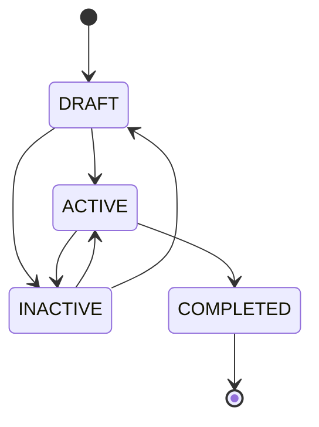

# PRD 02 - Sprints et catalogue

**Modules couverts :** `aidev_api/src/sprints` (`sprints.controller.ts`, `sprints.service.ts`, `enrolled-count.util.ts`) | `aidevsprint/src/lib/edition.ts`, `aidevsprint/src/components/hero/SeatsGauge.tsx`, `aidevsprint/src/components/layout/Navbar.tsx`, `aidevsprint/src/app/admin/(panneau)/sprints`

---

## 1. Objectif & Périmètre

Gérer le cycle de vie complet des sessions de formation (« Sprints ») : création en brouillon ou lancement immédiat, tarification Solo et forfait Duo, planification calendaire, gestion des capacités et exposition publique du catalogue vers le site vitrine.

---

## 2. Acteurs & Rôles

| Acteur | Permissions et actions |
|---|---|
| Visiteur / Participant | Consulte la liste publique des sprints visibles (`ACTIVE` et `INACTIVE` via `GET /sprints`) et accède au détail d'une session ouverte (`ACTIVE` uniquement). |
| Administrateur (`ADMIN`) | Crée, édite, change le statut (`DRAFT`, `ACTIVE`, `INACTIVE`, `COMPLETED`) et supprime (sous condition) les sprints depuis `/admin/sprints`. |

---

## 3. Modèle de données & Contrats (As-Is)

### 3.1 Table PostgreSQL `sprints` (`Sprint`)

| Colonne | Type SQL | Règles & notes |
|---|---|---|
| `id` | `SERIAL` | Clé primaire |
| `name` | `VARCHAR(150)` | Nom public de l'édition |
| `slug` | `VARCHAR(190)` | Unique (`sprints_slug_key`), requis à la création, immuable après création |
| `description` | `TEXT` (nullable) | Description facultative |
| `price_xof` | `INTEGER` | Prix du forfait Solo (`> 0`), en XOF |
| `minimum_payment_xof` | `INTEGER` | Minimum de premier versement Solo (`>= 1` et `<= price_xof`) |
| `duo_price_xof` | `INTEGER` (nullable) | Prix forfait Duo pour 2 places (ajouté par `0002_duo_forfaits`) |
| `duo_minimum_payment_xof` | `INTEGER` (nullable) | Minimum de versement Duo (`>= 1` et `<= duo_price_xof`) |
| `start_at` / `end_at` | `TIMESTAMP(3)` | Dates de début et de fin (`end_at > start_at`) |
| `capacity` | `INTEGER` (nullable) | Capacité maximale en places (`null` = capacité illimitée) |
| `status` | `SprintStatus` | Enum : `'DRAFT' | 'ACTIVE' | 'INACTIVE' | 'COMPLETED'` (défaut `'DRAFT'`) |
| `created_at` / `updated_at` | `TIMESTAMP(3)` | Horodatage |

### 3.2 Machine à états `SprintStatus`

---

## 4. Fonctionnalités & Règles de gestion (As-Is)

### 4.1 Validation tarifaire et calendaire (`SprintsService`)

- **RG-SPR-01 (Cohérence Solo)** : `minimumPaymentXof` doit être strictement compris entre `1` et `priceXof` (`400 MINIMUM_EXCEEDS_PRICE`).
- **RG-SPR-02 (Cohérence Duo)** : `duoMinimumPaymentXof` ne peut pas être défini sans `duoPriceXof` (`400 DUO_MINIMUM_WITHOUT_PRICE`) et doit vérifier `duoMinimumPaymentXof <= duoPriceXof` (`400 DUO_MINIMUM_EXCEEDS_PRICE`). Pour désactiver le forfait Duo sur un sprint existant, `PATCH /sprints/:id` accepte `duoPriceXof: null`.
- **RG-SPR-03 (Dates)** : `endAt` doit être strictement postérieur à `startAt` (`400 INVALID_DATES`).
- **RG-SPR-04 (Immuabilité du slug et isolation des dossiers existants)** : `UpdateSprintDto` n'expose ni `slug` ni `status` (tout envoi est rejeté par `forbidNonWhitelisted`). Modifier les prix d'un sprint n'affecte que les futures inscriptions : les inscriptions déjà créées conservent leur `totalAmountXof` figé.

### 4.2 Cycle de vie et suppression

- **RG-SPR-05 (Transitions autorisées)** : `PATCH /sprints/:id/status` valide la transition selon `SPRINT_TRANSITIONS` (`DRAFT -> ACTIVE, INACTIVE` ; `ACTIVE -> INACTIVE, COMPLETED` ; `INACTIVE -> ACTIVE, DRAFT` ; `COMPLETED -> []`), sinon `400 INVALID_STATUS_TRANSITION`. Un sprint `COMPLETED` est définitif.
- **RG-SPR-06 (Protection contre la suppression)** : `DELETE /sprints/:id` échoue avec `409 HAS_ENROLLMENTS` dès qu'au moins une inscription est rattachée au sprint.

### 4.3 Exposition publique (`GET /sprints`, `GET /sprints/:id`, `GET /sprints/:id/enrolled-count`)

- **RG-SPR-07 (Catalogue public `listPublic`)** : `GET /sprints` retourne les sprints `ACTIVE` (inscriptions ouvertes) et `INACTIVE` (utilisés par le frontend pour afficher les sessions à venir / « Bientôt »), triés par `createdAt desc`, à l'exclusion de `DRAFT` et `COMPLETED`. Chaque élément retourné inclut les compteurs publics `enrolledCount` et `enrolledSeats`.
- **RG-SPR-08 (Détail public)** : `GET /sprints/:id` ne retourne que les sprints `ACTIVE` (`404 SPRINT_NOT_FOUND` pour tout autre statut afin de ne pas divulguer de brouillons), enrichis avec `enrolledCount` et `enrolledSeats`.
- **RG-SPR-09 (Compteur public d'inscrits `enrolledCount` / `enrolledSeats` et route dédiée)** :
  - Calcul dans `aidev_api/src/sprints/enrolled-count.util.ts` (`thresholdForEnrollment`, `isEnrolled`, `countEnrolled`) : un dossier non annulé (`status != 'CANCELLED'`) compte comme inscrit dès que la somme de ses paiements `SUCCESS` est supérieure ou égale au seuil du sprint (`duoMinimumPaymentXof` pour un dossier `DUO` lorsque défini, sinon `minimumPaymentXof`).
  - `enrolledCount` compte le nombre de dossiers qualifiés ; `enrolledSeats` compte les personnes inscrites (un dossier `DUO` qualifié vaut 2 places, aligné sur `capacity`).
  - `GET /sprints/:id/enrolled-count` expose uniquement `{ sprintId, enrolledCount, enrolledSeats, capacity }` pour les sprints du catalogue public (`ACTIVE` et `INACTIVE`), et renvoie `404 SPRINT_NOT_FOUND` pour un sprint inconnu, `DRAFT` ou `COMPLETED`.

### 4.4 Adaptation côté Frontend (`edition.ts`, `SeatsGauge.tsx`, `Navbar.tsx`)

- Le frontend convertit les sprints API via `versEdition()` (`src/lib/edition.ts`) en mappant `inscrits: sprint.enrolledSeats ?? sprint.enrolledCount ?? null`.
- Dans [`SeatsGauge.tsx`](file:///c:/projets/les_ultra_dev/aidevclassroom/aidevsprint/src/components/hero/SeatsGauge.tsx) et [`Navbar.tsx`](file:///c:/projets/les_ultra_dev/aidevclassroom/aidevsprint/src/components/layout/Navbar.tsx), `quotaConnu` (`quota !== null && quota > 0`) et `inscritsConnus` (`inscrits !== null`) sont évalués séparément :
  - si les deux sont connus : la jauge affiche `{inscrits} / {quota} places réservées` (et `· complet` si `inscrits >= quota`) et le bandeau mobile affiche `{placesRestantes} places restantes` ;
  - si seul le quota est connu (API sans compteur ou réponse en cache antérieure) : la jauge affiche `[À DÉTERMINER] / {quota} places réservées` et le bandeau mobile `[À DÉTERMINER] places restantes · {quota} places` ;
  - si le quota n'est pas défini (`null` ou `<= 0`) : affichage `[À DÉTERMINER]`.
- Les sessions `ACTIVE` alimentent le Hero, la section Session et la modale d'inscription ; les sessions `INACTIVE` restent visibles en consultation publique (« Bientôt ») dans la section Parcours.
- Dans `/admin/sprints/nouveau`, le slug est généré automatiquement à la saisie du nom via `slugifie()` tant que l'admin ne l'a pas édité manuellement.

---

## 5. Routes API & Écrans Frontend (As-Is)

### 5.1 Endpoints Backend (`/api/v1`)

| Méthode | Route | Auth | Description |
|---|---|---|---|
| `GET` | `/sprints` | Public | Catalogue paginé (`page`, `limit`) des sprints `ACTIVE` et `INACTIVE`, chacun enrichi avec `enrolledCount` et `enrolledSeats` |
| `GET` | `/sprints/:id/enrolled-count` | Public | Compteur public `{ sprintId, enrolledCount, enrolledSeats, capacity }` (sprint `ACTIVE` ou `INACTIVE`) |
| `GET` | `/sprints/:id` | Public | Fiche d'un sprint `ACTIVE` uniquement, enrichie avec `enrolledCount` et `enrolledSeats` |
| `GET` | `/admin/sprints` | JWT `ADMIN` | Liste paginée avec filtre optionnel `status` |
| `GET` | `/admin/sprints/:id` | JWT `ADMIN` | Fiche complète tous statuts |
| `POST` | `/sprints` | JWT `ADMIN` | Crée un sprint (`status` optionnel, défaut `DRAFT`) |
| `PATCH` | `/sprints/:id` | JWT `ADMIN` | Met à jour nom, description, prix/minimum Solo & Duo, dates, capacité |
| `PATCH` | `/sprints/:id/status` | JWT `ADMIN` | Transitionne le statut |
| `DELETE` | `/sprints/:id` | JWT `ADMIN` | Supprime un sprint sans inscription |

### 5.2 Écrans Frontend (`aidevsprint`)

| Route / Fichier | Rôle |
|---|---|
| `/` ([`page.tsx`](file:///c:/projets/les_ultra_dev/aidevclassroom/aidevsprint/src/app/page.tsx)) | Consomme `GET /sprints` côté SSR pour hydrater les tarifs, dates et la modale d'inscription |
| `/admin/sprints` ([`page.tsx`](file:///c:/projets/les_ultra_dev/aidevclassroom/aidevsprint/src/app/admin/(panneau)/sprints/page.tsx)) | Liste paginée, filtre par statut, actions de transition rapide (« Lancer », « Mettre en pause », etc.) |
| `/admin/sprints/nouveau` ([`page.tsx`](file:///c:/projets/les_ultra_dev/aidevclassroom/aidevsprint/src/app/admin/(panneau)/sprints/nouveau/page.tsx)) | Formulaire de création avec option « Lancer » dès la création (`ACTIVE`) |
| `/admin/sprints/[id]/modifier` ([`page.tsx`](file:///c:/projets/les_ultra_dev/aidevclassroom/aidevsprint/src/app/admin/(panneau)/sprints/[id]/modifier/page.tsx)) | Édition des champs modifiables (slug non éditable) |

---

## 6. Cas limites, Sécurité & Erreurs

- **Confidentialité et règle de qualification du compteur public** : l'API publique n'expose que des agrégats anonymes (`enrolledCount`, `enrolledSeats`, `capacity`) sans données nominatives ni détail des dossiers ; un dossier non annulé n'incrémente les compteurs qu'une fois le cumul de ses paiements `SUCCESS` supérieur ou égal au seuil minimum du forfait (`duoMinimumPaymentXof` pour un `DUO` si défini, sinon `minimumPaymentXof`).
- **Codes d'erreur** : `409 SLUG_EXISTS`, `409 HAS_ENROLLMENTS`, `400 MINIMUM_EXCEEDS_PRICE`, `400 DUO_MINIMUM_WITHOUT_PRICE`, `400 DUO_MINIMUM_EXCEEDS_PRICE`, `400 INVALID_DATES`, `400 INVALID_STATUS_TRANSITION`, `404 SPRINT_NOT_FOUND`.
- **Suppression côté API** : `DELETE /sprints/:id` refuse la suppression avec `409 HAS_ENROLLMENTS` tant qu'au moins une inscription existe pour ce sprint.

---

## 7. Évolutions prévues (To-Be)

1. **Métadonnées logistiques en base** : déplacer les attributs aujourd'hui codés en dur dans `FAITS_LOCAUX` (`ville`, `lieu`, `format`, `horaires`) vers des champs dédiés du modèle `Sprint`.
2. **Filtrage et tri multi-critères** : ajouter la recherche textuelle et le tri par date de session sur `/admin/sprints`.
3. **Rafraîchissement client périodique du compteur** : consommer `GET /sprints/:id/enrolled-count` côté client pour actualiser la jauge de places sans attendre l'expiration du cache ISR (`revalider: 900`) de `GET /sprints`.
