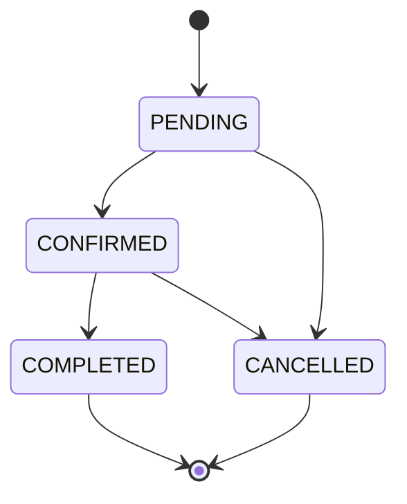

# PRD 03 - Inscriptions et participants

**Modules couverts :** `aidev_api/src/enrollments`, `aidev_api/src/students`, `aidev_api/src/common/guards/tracking-token.guard.ts` | `aidev_front/src/components/inscription`, `aidev_front/src/components/paiement/ReprendrePaiement.tsx`, `aidev_front/src/app/admin/(panneau)/inscriptions`

---

## 1. Objectif & Périmètre

Gérer l'identification des participants (`Student`), l'inscription à un sprint en forfait Solo (`SINGLE`) ou Duo (`DUO`, 2 places avec coordonnées du binôme), le contrôle concurrent de capacité, le suivi sécurisé par jeton anonyme (`trackingToken`), la reprise de dossier par e-mail et le suivi administratif des inscriptions.

---

## 2. Acteurs & Rôles

| Acteur | Permissions et actions |
|---|---|
| Participant (visiteur public) | S'inscrit via la modale (`POST /enrollments`), consulte son dossier grâce au `trackingToken` (`GET /enrollments/:id/status`), retrouve ses dossiers par e-mail (`/paiement/reprendre`). |
| Administrateur (`ADMIN`) | Liste, filtre et recherche les inscriptions (`/admin/inscriptions`), consulte le détail complet et les paiements associés (`/admin/inscriptions/[id]`), fait évoluer le statut du dossier. Gère également les fiches `Student` via l'API. |

---

## 3. Modèle de données & Contrats (As-Is)

### 3.1 Tables PostgreSQL `students` et `enrollments`

**Table `students` :** `id`, `first_name` (`VARCHAR(100)`), `last_name` (`VARCHAR(100)`), `email` (`VARCHAR(190)`, unique), `phone` (`VARCHAR(30)`, indexé), `created_at`, `updated_at`.

**Table `enrollments` :**

| Colonne | Type SQL | Contraintes & notes |
|---|---|---|
| `id` | `SERIAL` | Clé primaire |
| `student_id` | `INTEGER` | FK vers `students(id)` (`ON DELETE RESTRICT`) |
| `sprint_id` | `INTEGER` | FK vers `sprints(id)` (`ON DELETE RESTRICT`) ; contrainte unique `(student_id, sprint_id)` |
| `plan` | `EnrollmentPlan` | Enum `'SINGLE' | 'DUO'` (défaut `'SINGLE'`, migration `0002_duo_forfaits`) |
| `partner_first_name` / `partner_last_name` | `VARCHAR(100)` (nullable) | Requis si `plan = 'DUO'` |
| `partner_phone` | `VARCHAR(30)` (nullable) | Requis si `plan = 'DUO'` (migration `0003_partner_phone`) |
| `total_amount_xof` | `INTEGER` | Montant total figé à l'inscription (`price_xof` ou `duo_price_xof`) |
| `status` | `EnrollmentStatus` | Enum `'PENDING' | 'CONFIRMED' | 'CANCELLED' | 'COMPLETED'` |
| `tracking_token_hash` | `VARCHAR(255)` | Empreinte SHA-256 du `trackingToken` ; jamais exposé côté API |

### 3.2 Machine à états `EnrollmentStatus`

Note : la transition `CONFIRMED -> COMPLETED` requiert impérativement `remainingAmountXof === 0` (`400 ENROLLMENT_NOT_SETTLED`).

---

## 4. Fonctionnalités & Règles de gestion (As-Is)

### 4.1 Déduplication des participants (`StudentsService`)

- **RG-STU-01 (Upsert silencieux par e-mail)** : `POST /students` et la création d'inscription normalisent l'e-mail (`trim` + minuscules) et le téléphone (format international `^\+[1-9]\d{6,17}$`). Si l'e-mail existe déjà, le participant existant est réutilisé sans erreur `409` ni fuite d'informations sensibles.
- **RG-STU-02 (Immuabilité de l'e-mail et pas de suppression)** : `PATCH /admin/students/:id` permet uniquement de modifier `firstName`, `lastName` et `phone`. Aucune route `DELETE /students` n'existe.

### 4.2 Règles métier d'inscription (`EnrollmentsService`)

- **RG-ENR-01 (Éligibilité du sprint)** : l'inscription n'est autorisée que si le sprint existe (`404 SPRINT_NOT_FOUND`) et est au statut `ACTIVE` (`422 SPRINT_NOT_ACTIVE`).
- **RG-ENR-02 (Forfait Solo vs Duo)** :
  - `SINGLE` (défaut) compte pour 1 place et fige `totalAmountXof = sprint.priceXof`.
  - `DUO` exige que `sprint.duoPriceXof` soit défini (`422 DUO_NOT_AVAILABLE`), exige `partnerFirstName`, `partnerLastName` (min 2 car.) et `partnerPhone` (`^\+[1-9]\d{6,17}$`) sous peine de `400 PARTNER_REQUIRED`, compte pour **2 places** et fige `totalAmountXof = sprint.duoPriceXof`.
- **RG-ENR-03 (Contrôle transactionnel de capacité et anti-doublon)** : dans une transaction PostgreSQL contrôlant les places occupées non `CANCELLED` (`SINGLE = 1`, `DUO = 2`), le total augmenté du besoin de la nouvelle inscription doit rester `<= capacity` (si `capacity != null`), sinon `409 SPRINT_CAPACITY_REACHED`. Une seconde inscription du même étudiant sur le même sprint échoue avec `409 DUPLICATE_ENROLLMENT`.
- **RG-ENR-04 (Calcul dynamique des soldes)** : toute réponse enrichie calcule `totalPaidXof` (somme des paiements `SUCCESS`) et `remainingAmountXof = max(0, totalAmountXof - totalPaidXof)`.

### 4.3 Jeton de suivi & Reprise par e-mail (`TrackingTokenGuard`)

- **RG-ENR-05 (Hashage SHA-256 à usage unique d'affichage)** : à la création, le serveur génère un `trackingToken` aléatoire, stocke son hash SHA-256 dans `tracking_token_hash` et ne renvoie le jeton en clair qu'une fois dans la réponse `201`. Côté navigateur, `aidev_front` le persiste dans `localStorage` (`aidevsprint.*`).
- **RG-ENR-06 (Récupération par e-mail avec rotation de jeton)** : `POST /enrollments/by-email` (`10 req/min`) recherche tous les dossiers d'un e-mail ; s'il en existe, il génère un **nouveau** `trackingToken` par dossier, écrase `tracking_token_hash` en base (invalidant l'ancien jeton) et renvoie les dossiers avec leurs nouveaux jetons et soldes. Si l'e-mail est inconnu, il retourne `{ dossiers: [] }`. **Limite assumée :** aucune vérification OTP par e-mail n'est demandée à ce stade.

---

## 5. Routes API & Écrans Frontend (As-Is)

### 5.1 Endpoints Backend (`/api/v1`)

| Méthode | Route | Auth / Throttle | Description |
|---|---|---|---|
| `POST` | `/students` | Public / `20 req/min` | Crée ou retrouve un étudiant de façon idempotente |
| `GET` | `/admin/students` | JWT `ADMIN` | Liste paginée avec recherche (`firstName`, `lastName`, `email`, `phone`) |
| `GET` | `/admin/students/:id` | JWT `ADMIN` | Fiche étudiant |
| `PATCH` | `/admin/students/:id` | JWT `ADMIN` | Mise à jour partielle (hors e-mail) |
| `GET` | `/admin/students/:id/enrollments` | JWT `ADMIN` | Historique des inscriptions de l'étudiant |
| `POST` | `/enrollments` | Public / `20 req/min` | Crée l'inscription et retourne `{ enrollment, trackingToken }` |
| `POST` | `/enrollments/by-email` | Public / `10 req/min` | Retrouve les dossiers par e-mail avec rotation de `trackingToken` |
| `GET` | `/enrollments/:id/status` | `TrackingTokenGuard` | État public minimal, soldes et liste restreinte des paiements |
| `GET` | `/admin/enrollments` | JWT `ADMIN` | Liste paginée filtrable (`sprintId`, `status`, `search`) |
| `GET` | `/admin/enrollments/:id` | JWT `ADMIN` | Détail complet avec soldes et paiements |
| `PATCH` | `/admin/enrollments/:id/status` | JWT `ADMIN` | Transition de statut (`PENDING -> CONFIRMED -> COMPLETED`, ou `CANCELLED`) |
| `GET` | `/admin/enrollments/:id/payments` | JWT `ADMIN` | Liste des paiements du dossier |

### 5.2 Écrans Frontend (`aidev_front`)

| Composant / Route | Description |
|---|---|
| `ModaleInscription` + `FormulaireInscription` | Choix du sprint actif, choix forfait Solo/Duo, coordonnées participant (+ binôme si Duo), enchaînement immédiat vers `ParcoursPaiement` |
| `/paiement/reprendre` (`ReprendrePaiement`) | Saisie e-mail -> appel `POST /api/enrollments/by-email` -> affichage des dossiers avec reste à payer > 0 et relance du tunnel de paiement |
| `/admin/inscriptions` | Tableau filtrable par statut et recherche texte, pagination conservée dans l'URL |
| `/admin/inscriptions/[id]` | Fiche détaillée : tableau des versements, soldes (« Total dû », « Déjà payé », « Reste »), fiche participant/binôme, boutons de transition autorisés |
| Gestion des étudiants (`/admin/students`) | Non implémentée dans l'UI frontend |

---

## 6. Cas limites, Sécurité & Erreurs

- **Vulnérabilité assumée sur `by-email`** : toute personne connaissant l'e-mail d'un participant peut obtenir un nouveau `trackingToken`, consulter le solde/statut de l'inscription (y compris le nom du sprint et le récapitulatif) et révoquer le jeton stocké sur l'appareil initial du participant.
- **Partage de quota via relais Next.js** : `POST /api/enrollments` (`20 req/min`) et `POST /api/enrollments/by-email` (`10 req/min`) passent par le relais Next.js `src/app/api/[...chemin]/route.ts`, qui ne transmet pas l'IP visiteur ; en charge réelle simultanée, plusieurs visiteurs partagent le même compteur throttler.
- **Données déjà payées et annulation** : le passage en `CANCELLED` libère la capacité du sprint mais ne déclenche aucun remboursement Paystack automatique.

---

## 7. Évolutions prévues (To-Be)

1. **Sécuriser `/enrollments/by-email` par OTP / lien magique** : envoyer un code à usage unique ou un lien signé sur l'e-mail saisi avant d'émettre ou de tourner un `trackingToken` (et ne pas écraser l'ancien jeton tant que la possession de la boîte mail n'est pas prouvée).
2. **Exposer la gestion des étudiants dans `/admin/participants`** : créer les écrans branchés sur `/admin/students*` pour corriger un numéro de téléphone ou consulter l'historique multi-sprints d'un participant.
3. **Transition automatique vers `CONFIRMED`** : documenter/unifier le choix métier entre confirmation manuelle par l'admin et confirmation automatique dès qu'un premier acompte `SUCCESS` est validé (si souhaité).
4. **Propager l'IP client dans `/api/[...chemin]`** : préserver le rate-limiting par utilisateur réel sur les créations d'inscriptions et recherches par e-mail.
