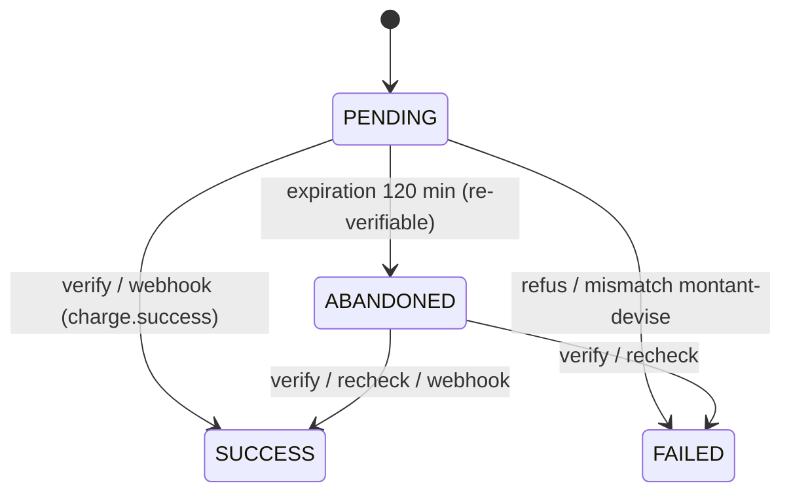

# PRD 04 - Paiements et Paystack

**Modules couverts :** `aidev_api/src/payments` (`PaymentsController`, `PaystackWebhookController`, `PaymentsService`, `PaystackService`, `PaymentAccessGuard`, `balance.util.ts`) | `aidev_front/src/lib/paiement.ts`, `aidev_front/src/components/inscription/ParcoursPaiement.tsx`, `aidev_front/src/components/paiement/RetourPaiement.tsx`, `aidev_front/src/app/paiement/retour/page.tsx`, `aidev_front/src/app/admin/(panneau)/paiements/page.tsx`

---

## 1. Objectif & Périmètre

Permettre aux participants de régler leur inscription en XOF en un ou plusieurs versements encadrés (acomptes puis solde), via deux parcours Paystack : débit Mobile Money direct sans redirection (`POST /charge` sur MTN, Orange ou Wave en Côte d'Ivoire) ou redirection vers Paystack Hosted Checkout (`POST /transaction/initialize`), avec réconciliation fiable par vérification serveur (`verify`), webhook HMAC-SHA512 et revérification manuelle côté back-office.

Les paiements par carte bancaire (PAN/CVV/PIN) sont volontairement exclus du périmètre produit.

---

## 2. Acteurs & Rôles

| Acteur | Permissions et actions |
|---|---|
| Participant (détenteur de `trackingToken`) | Initialise un versement (total ou partiel) et déclenche la vérification d'une transaction à son retour de paiement. |
| Paystack (système externe) | Exécute les transactions et notifie l'API de manière asynchrone via le webhook signé `charge.success`. |
| Administrateur (`ADMIN`) | Consulte tous les paiements filtrés (`/admin/paiements`) et relance une vérification fournisseur (`recheck`). |

---

## 3. Modèle de données & Contrats (As-Is)

### 3.1 Table PostgreSQL `payments` (`Payment`)

| Colonne | Type SQL | Contraintes & notes |
|---|---|---|
| `id` | `SERIAL` | Clé primaire |
| `enrollment_id` | `INTEGER` | FK vers `enrollments(id)` (`ON DELETE RESTRICT`) |
| `amount_xof` | `INTEGER` | Montant entier en XOF du versement |
| `currency` | `VARCHAR(10)` | Défaut `'XOF'` |
| `reference` | `VARCHAR(100)` | Unique (`payments_reference_key`), référence interne générée (`sp_...`) |
| `provider_reference` | `VARCHAR(100)` (nullable) | Référence retournée par Paystack (indexée) |
| `status` | `PaymentStatus` | Enum `'PENDING' | 'SUCCESS' | 'FAILED' | 'ABANDONED'` |
| `authorization_url` | `TEXT` (nullable) | URL Hosted Checkout (null en mode Charge directe) |
| `paid_at` | `TIMESTAMP(3)` (nullable) | Date de confirmation du règlement |
| `provider_response` | `JSONB` (nullable) | Réponse Paystack expurgée par `sanitizeProviderPayload()` |
| `created_at` / `updated_at` | `TIMESTAMP(3)` | Horodatage |

### 3.2 Cycle de vie `PaymentStatus`

---

## 4. Fonctionnalités & Règles de gestion (As-Is)

### 4.1 Calcul du solde et validation des montants (`balance.util.ts`)

- **RG-PAY-01 (Montants entiers et conversion x100)** : tous les montants applicatifs sont des entiers en XOF. `toProviderAmount()` multiplie systématiquement par `100` pour l'API Paystack (y compris en `XOF`), et `fromProviderAmount()` divise par `100` au retour.
- **RG-PAY-02 (Versements échelonnés et réservation des `PENDING`)** :
  - `totalPaidXof` = somme des paiements `SUCCESS`.
  - `remaining` = `max(0, totalAmountXof - totalPaidXof)`.
  - Dans `PaymentsService.initialize()`, une transaction PostgreSQL avec verrou `SELECT ... FOR UPDATE` sur l'inscription expire d'abord les `PENDING` vieux de plus de `PAYSTACK_PENDING_RESERVE_MINUTES` (`120` min par défaut -> `ABANDONED`), puis soustrait la somme des `PENDING` encore actifs du solde disponible afin d'empêcher deux paiements parallèles de dépasser le total dû.
- **RG-PAY-03 (Règle du minimum et du reliquat)** :
  - `amountXof` doit être un entier `> 0` (`400 PAYMENT_AMOUNT_INVALID`), et `remaining > 0` (`409 ENROLLMENT_ALREADY_SETTLED`).
  - `minimum` = `duoMinimumPaymentXof` si `enrollment.plan === 'DUO'` et `duoMinimumPaymentXof` défini, sinon `minimumPaymentXof`.
  - Exception critique : `amountXof === remaining` est toujours autorisé même si `remaining < minimum`, afin qu'un reliquat inférieur au minimum ne reste jamais impayable.
  - Sinon : `amountXof >= minimum` (`400 PAYMENT_AMOUNT_BELOW_MINIMUM`) et `amountXof <= remaining` (`409 PAYMENT_AMOUNT_EXCEEDS_BALANCE`).

### 4.2 Double parcours Paystack : Charge Mobile Money vs Hosted Checkout

- **RG-PAY-04 (Branchement Charge vs Checkout)** :
  - Lorsque `{ provider, phone }` sont fournis et `PAYSTACK_CHARGE_ENABLED=true` :
    - Opérateurs supportés : `mtn`, `orange`, `wave` (`PAYSTACK_CHARGE_PROVIDERS`).
    - Format téléphone strict : `^225\d{10}$` (`400`, pas de collecte de PIN/OTP/carte).
    - Garde anti-double-clic : bloque une nouvelle charge identique `PENDING` de moins de 10 minutes.
    - `PaystackService.chargeMobileMoney()` appelle `POST /charge` et mappe `data.status` : `success` (immédiat), `pay_offline` -> `pending_user_action` (validation USSD/app sur téléphone + `display_text`), `pending`, `send_otp` -> `otp_required`, sinon `failed`.
    - Côté serveur/client, la vérification peut s'appuyer sur la scrutation bornée (`pollTransactionVerification` : timeout `180000` ms, intervalle `5000` ms), le webhook `charge.success` ou une vérification manuelle.
  - Sans `provider` (ou si `PAYSTACK_CHARGE_ENABLED` est désactivé côté serveur) : `PaystackService.initializeTransaction()` appelle `POST /transaction/initialize` avec `callback_url = PAYSTACK_CALLBACK_URL`, persiste `authorizationUrl` et laisse le frontend rediriger l'utilisateur vers Paystack.
  - Résilience si Paystack est indisponible à l'init : le `PENDING` reste en base (`503 PAYSTACK_UNAVAILABLE`) et reste vérifiable ultérieurement.

### 4.3 Vérification serveur, Webhook et Sécurité

- **RG-PAY-05 (Vérification idempotente & anti-tampering)** : `GET /payments/:reference/verify` (`PaymentAccessGuard` : JWT `ADMIN` ou `trackingToken` de l'inscription) retourne immédiatement si déjà `SUCCESS`. Un `FAILED` de moins de `PAYSTACK_FAILED_SHORT_CIRCUIT_MINUTES` (`15` min) est court-circuité. Sinon, `verifyTransaction()` vérifie que Paystack retourne `status = 'success'`, la même `reference`, le bon montant (`fromProviderAmount(amount) === payment.amountXof`) et la bonne devise (`XOF`), avant de passer à `SUCCESS` et de mémoriser `paidAt` + `sanitizeProviderPayload()` (sinon `FAILED` + `422 PAYMENT_VERIFICATION_MISMATCH`).
- **RG-PAY-06 (Webhook HMAC-SHA512)** : `POST /payments/webhook/paystack` vérifie `x-paystack-signature` sur le `rawBody` Express via `timingSafeEqual` et `PAYSTACK_SECRET_KEY` (sinon `400 INVALID_WEBHOOK_SIGNATURE`). Seul l'événement `charge.success` déclenche `verify()`.
- **RG-PAY-07 (Sécurité redirection navigateur)** : `adressePaiementValide()` dans `aidev_front/src/lib/paiement.ts` refuse toute redirection hors HTTPS sur les domaines `paystack.com` / `paystack.co`.

---

## 5. Routes API & Écrans Frontend (As-Is)

### 5.1 Endpoints Backend (`/api/v1`)

| Méthode | Route | Auth | Description |
|---|---|---|---|
| `POST` | `/payments/enrollments/:id/initialize` | `TrackingTokenGuard` | Initialise un paiement Checkout ou Charge Mobile Money |
| `GET` | `/payments/:reference/verify` | `PaymentAccessGuard` (Admin ou `trackingToken`) | Vérifie le statut auprès de Paystack et retourne les soldes |
| `POST` | `/payments/webhook/paystack` | Signature HMAC-SHA512 | Réception des événements `charge.success` |
| `GET` | `/admin/payments` | JWT `ADMIN` | Liste paginée filtrable (`enrollmentId`, `status`, `reference`) |
| `GET` | `/admin/payments/:id` | JWT `ADMIN` | Fiche détaillée d'un paiement |
| `POST` | `/admin/payments/:id/recheck` | JWT `ADMIN` | Relance `verify()` pour tout paiement ciblé |

### 5.2 Écrans Frontend (`aidev_front`)

| Composant / Route | Description |
|---|---|
| `ParcoursPaiement.tsx` | Choix du montant (acompte minimum -> total restant), sélection opérateur (`mtn`, `orange`, `wave`) + numéro `225...` si Charge actif, ou bouton Checkout si bascule Checkout |
| `/paiement/retour` (`RetourPaiement.tsx`) | Lit `?reference=`/`?trxref=`, retrouve le `trackingToken` dans `localStorage` (`litTrace`), appelle `verify`, gère les états `sans-reference`, `sans-jeton` (secours WhatsApp), `PENDING`, `FAILED/ABANDONED`, `SUCCESS` partiel (bouton « Régler le reste ») ou soldé |
| `/admin/paiements` | Tableau filtrable par statut et référence + action « Revérifier » (affichée uniquement lorsque `status === 'PENDING'`) |

---

## 6. Cas limites, Sécurité & Erreurs

- **Écart de documentation historique** : `aidev_api/docs/frontend/payments.md` indique à tort que XOF n'est pas multiplié par 100 et cite `BELOW_MINIMUM` au lieu du code réel `PAYMENT_AMOUNT_BELOW_MINIMUM` (`balance.util.ts`).
- **Bouton « Revérifier » limité aux `PENDING` dans l'UI** : bien que `POST /admin/payments/:id/recheck` supporte la revérification d'un paiement `ABANDONED` (expiré après 120 min mais payé tardivement), `/admin/paiements/page.tsx` masque le bouton lorsque `status !== 'PENDING'`.
- **Codes d'erreur principaux** : `400 PAYMENT_AMOUNT_INVALID`, `400 PAYMENT_AMOUNT_BELOW_MINIMUM`, `400 INVALID_WEBHOOK_SIGNATURE`, `409 PAYMENT_AMOUNT_EXCEEDS_BALANCE`, `409 ENROLLMENT_ALREADY_SETTLED`, `422 ENROLLMENT_CANCELLED`, `422 PAYMENT_VERIFICATION_MISMATCH`, `502 PAYSTACK_VERIFY_FAILED`, `503 PAYSTACK_UNAVAILABLE`.

---

## 7. Évolutions prévues (To-Be)

1. **Permettre la revérification UI des paiements `ABANDONED`** : afficher le bouton « Revérifier » sur les paiements `ABANDONED` dans `/admin/paiements` afin qu'un admin puisse réconcilier sans appel API direct un règlement arrivé après la fenêtre de 120 minutes.
2. **Notifications automatiques post-paiement** : envoyer un e-mail / message WhatsApp de confirmation (reçu, référence Paystack, reste éventuel, lien de reprise) lors du passage d'un paiement à `SUCCESS`.
3. **Gestion UI d'une nouvelle tentative `FAILED` sur `/paiement/retour`** : permettre de relancer un nouveau paiement directement depuis `/paiement/retour` sans obliger à revenir à l'accueil ou `/paiement/reprendre`.
4. **Synchronisation des documentations `docs/frontend/`** : mettre à jour `payments.md` et `errors.md` avec le facteur `x100` XOF, `PAYMENT_AMOUNT_BELOW_MINIMUM` et les paramètres `provider`/`phone`.

